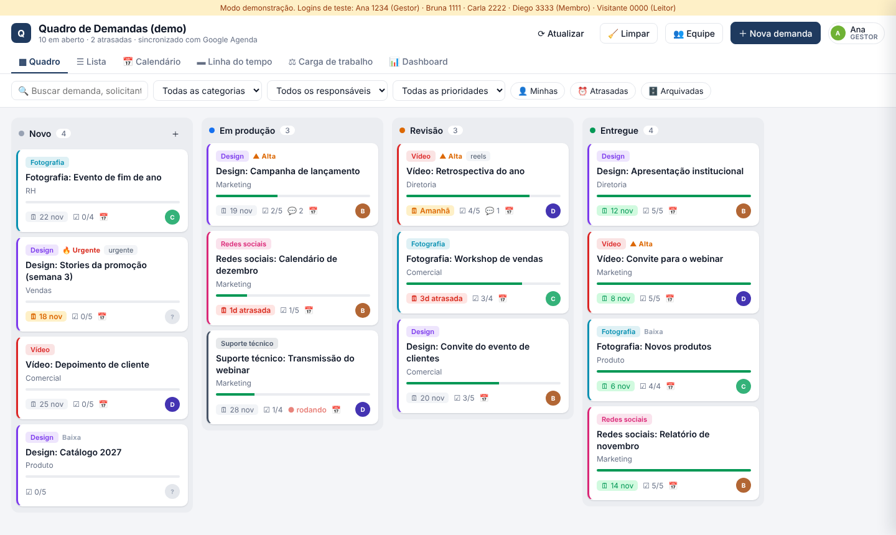
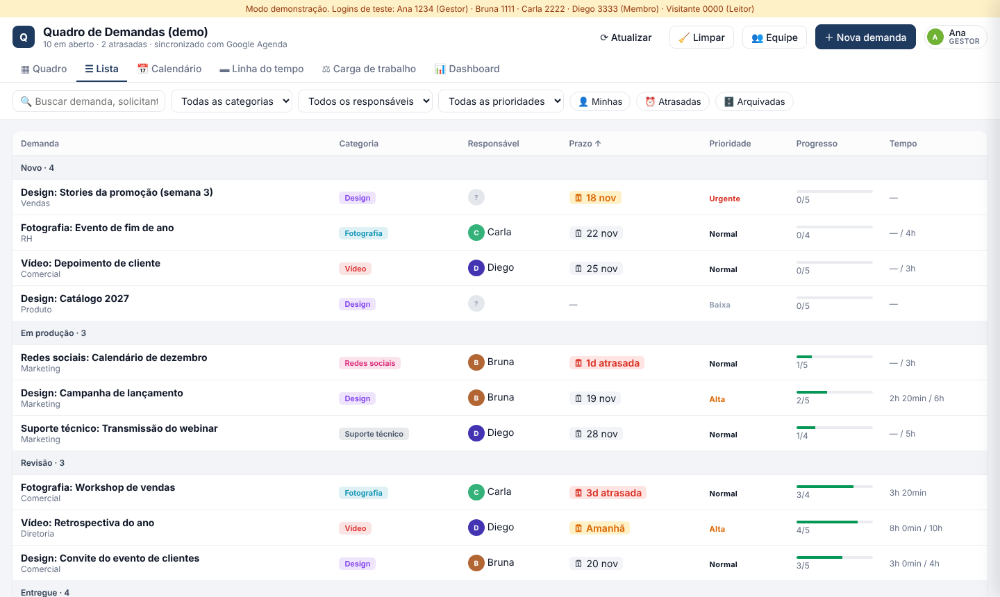
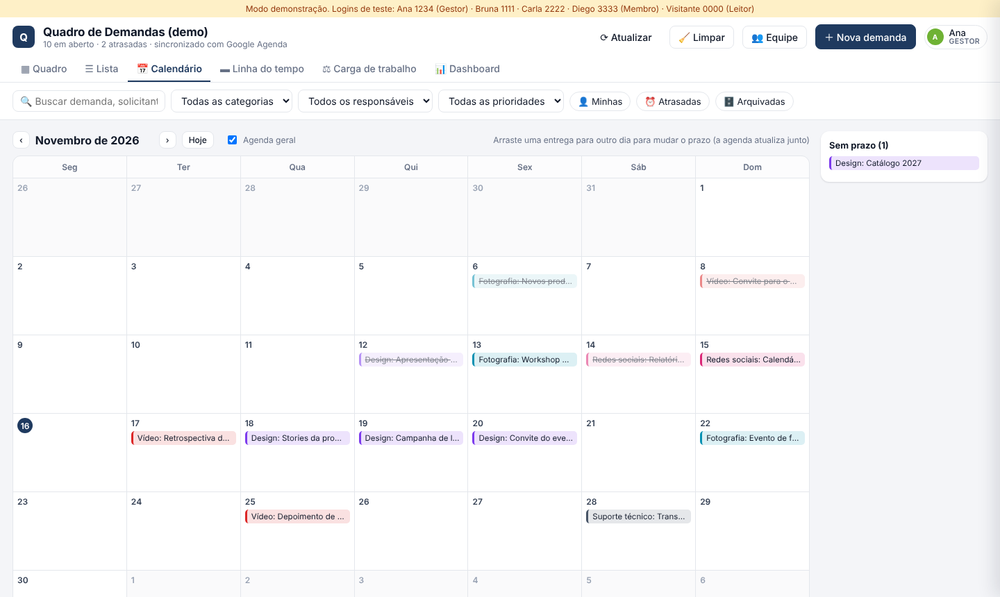
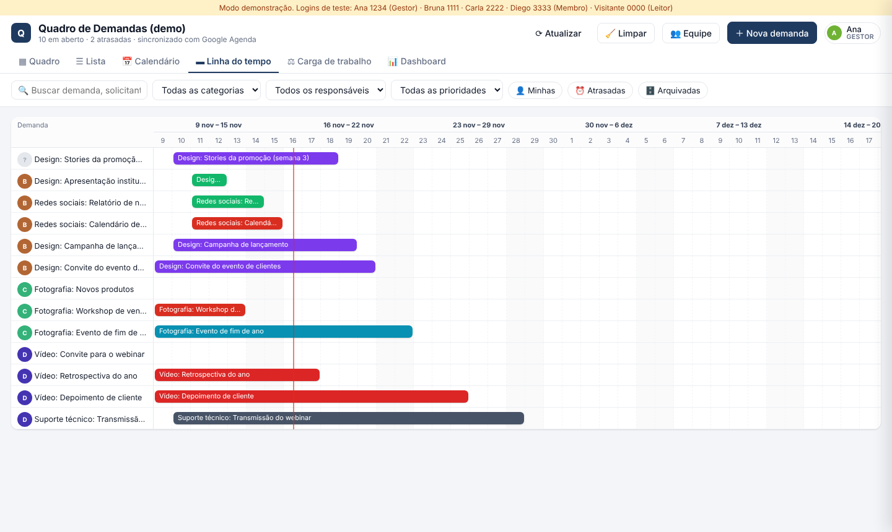
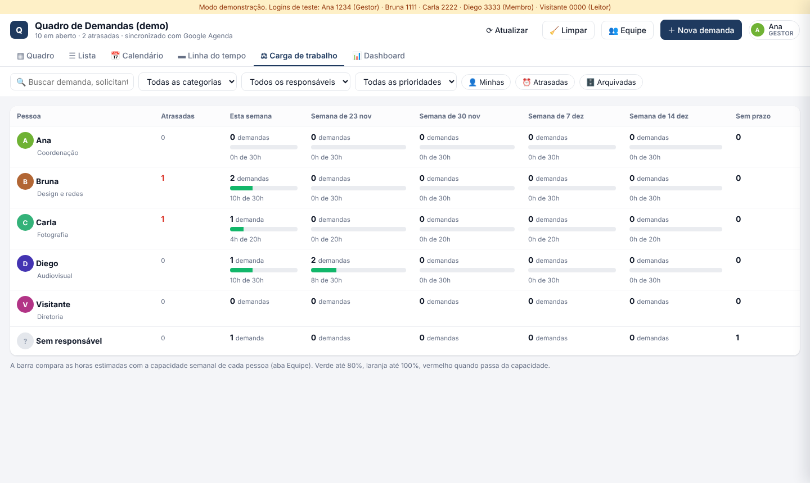
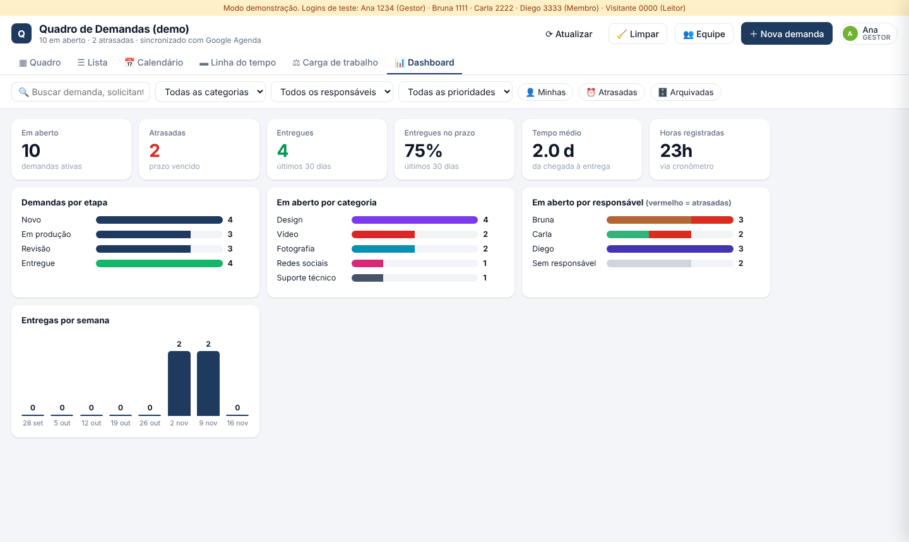
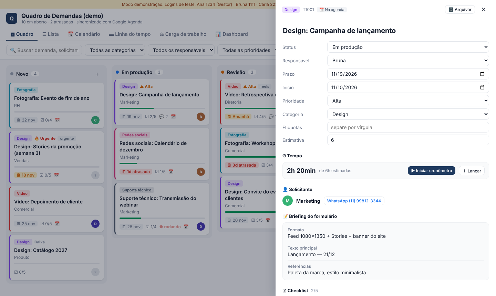
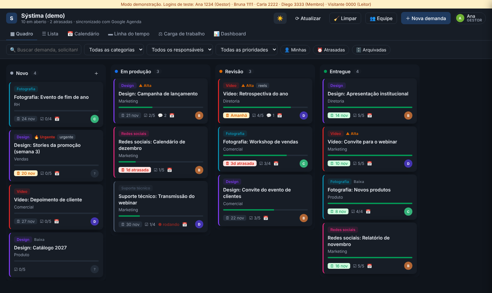

# Sýstima

**Quadro de demandas para equipes de comunicação e criação.** Gestão de demandas no estilo Trello/ClickUp que roda **100% dentro do Google Workspace**: Planilhas + Apps Script + Forms + Agenda. Não tem mensalidade nem servidor, e funciona com uma conta Gmail gratuita.

As demandas chegam pelo **Google Forms**, viram cards num **Kanban**, são distribuídas para os responsáveis por regras e aparecem no **Google Agenda** da equipe.



> 🧪 Abra `src/Index.html` direto no navegador para ver o **modo demonstração** com dados fictícios.
> Logins de teste: `Ana / 1234` (Gestor), `Bruna / 1111` (Membro), `Visitante / 0000` (Leitor).

---

## Recursos

| | |
|---|---|
| **6 visualizações** | Quadro (Kanban), Lista, Calendário, Linha do tempo (Gantt), Carga de trabalho e Dashboard |
| **Google Forms → cards** | Cada resposta vira um card. Uma resposta pode **gerar vários cards, um por área** (ex.: arte, vídeo e fotografia do mesmo evento) |
| **Google Agenda** | A entrega vira evento na agenda do setor, com o responsável como convidado. Mudou o prazo, o responsável ou o status, o evento se atualiza |
| **Agenda geral no Calendário** | Mostra os eventos da agenda da organização ao lado das entregas |
| **Perfis e login por PIN** | Gestor, Membro e Leitor, com as regras validadas no servidor |
| **Gestor interino** | Delegação temporária da gestão, com data para acabar |
| **Tela de Equipe** | Adicionar, editar, remover ou reativar pessoas, gerar PIN e enviar acesso por e-mail, sem abrir a planilha |
| **Automações** | Regras "Quando → Se → Então" (estilo Butler/ClickUp) configuradas numa aba |
| **Modelos por categoria** | Responsável padrão, checklist e prazo (SLA) automáticos |
| **Demandas recorrentes** | Criadas direto no quadro: todos os dias, toda semana, a cada 2 semanas, todo mês ou a cada N dias. Pausar e retomar pelo card ou pelo painel 🔁 Recorrentes |
| **Cor de fundo** | Botão 🎨: cores prontas ou qualquer cor. Cada pessoa escolhe a sua (fica no navegador); o gestor pode definir uma para a equipe toda (chave `COR_FUNDO` na aba Config). As colunas se ajustam à cor para continuar legíveis |
| **Avisos** | Pop-up de nova demanda, e-mails (responsável, solicitante, coordenação, @menções), resumo diário às 7h e webhook (Make/Z-API para WhatsApp) |
| **Cronômetro e estimativas** | Tempo gasto × estimado e carga semanal × capacidade de cada pessoa |
| **Histórico, comentários, anexos e checklists** | Por card |
| **Importar do Trello** | Por JSON exportado ou pela API, com mapeamento de listas e membros. Reimportar não duplica |
| **Modo escuro** | Botão 🌙 no topo. Segue o tema do sistema na primeira visita e lembra a escolha de cada pessoa |
| **Limpar quadro** | Tudo, só o que veio do Trello ou só as arquivadas, com backup automático |

<details><summary>Mais telas</summary>

| | |
|---|---|
|  |  |
|  |  |
|  |  |
|  | |

</details>

---

## Estrutura

```
src/
  Code.gs           Backend: Forms, regras, automações, agenda, e-mails e API do quadro
  Index.html        O quadro. Fora do Google, roda em modo demonstração
  Importar.html     Página de importação do Trello (só Gestor)
  appsscript.json   Manifesto: fuso horário e app da web
docs/               Capturas de tela
```

---

## Instalação

### Opção A: script vinculado à planilha (recomendado)

1. No Google Forms, vá em **Respostas → Vincular ao Planilhas → Criar nova planilha**. Use a conta que vai ser dona do sistema, de preferência a conta do setor.
2. Na planilha, abra **Extensões → Apps Script**.
3. Cole o conteúdo dos arquivos:
   - `Code.gs` no arquivo `Código.gs`;
   - `Index.html` num arquivo **HTML** novo chamado `Index`;
   - `Importar.html` num arquivo **HTML** novo chamado `Importar`;
   - `appsscript.json`: ative *Configurações do projeto → Mostrar arquivo de manifesto* e cole.
4. Recarregue a planilha. Vai aparecer o menu **📋 Quadro**. Rode **1. Configurar planilha** e autorize. Na tela "O Google não verificou este app", clique em *Avançado → Acessar*. É normal: o script é seu.
5. Preencha as abas **Equipe**, **Categorias** e **Mapeamento** (veja abaixo).
6. Rode **📋 Quadro → 2. Ativar automações**.
7. No editor, vá em **Implantar → Nova implantação → App da Web**, com:
   - Executar como: **Eu**;
   - Quem pode acessar: **Qualquer pessoa**. O conteúdo é protegido pelo login com nome + PIN.
8. Use **📋 Quadro → Enviar acesso** para mandar o link e o PIN para a equipe.

### Opção B: projeto avulso

Se não der para abrir o Apps Script pela planilha, crie um projeto em [script.google.com](https://script.google.com) e preencha `PLANILHA_ID` no topo do `Code.gs`. Nesse modo, o menu **📋 Quadro** não aparece na planilha. Rode `configurarPlanilha` e `ativarGatilhos` pelo editor (**Executar**).

### Com clasp (opcional)

```bash
npm i -g @google/clasp
clasp login
clasp create --type sheets --title "Sýstima" --rootDir src
clasp push
```

> Ao atualizar o código, use **Implantar → Gerenciar implantações → ✏️ → Nova versão** para manter o mesmo link.

---

## Configuração (abas da planilha)

| Aba | O que define |
|---|---|
| **Config** | Nome, colunas do Kanban, cor, e-mail da coordenação, agenda, webhook e código de acesso opcional |
| **Equipe** | Nome, e-mail, função, horas por semana, perfil, PIN, ativo e "gestor interino até" |
| **Categorias** | Responsável padrão, cor, SLA (dias) e checklist padrão |
| **Mapeamento** | Qual pergunta do Forms alimenta cada campo do card |
| **Desdobramento** | Regras para uma resposta gerar vários cards, com a categoria e o prazo de cada um. No briefing de cada card, as perguntas de entregáveis mostram só as opções daquela área. Colunas opcionais: **Item no card** troca o texto da opção (ex.: "Material gráfico (Certificados, Panfleto, Banner)" vira "Certificados" num card e "Panfleto e Banner" em outro); **Responsável** manda aquele item para uma pessoa em vez do responsável da categoria (vira um card separado); **A partir de** faz o Responsável valer só desde essa data, para trocas de função programadas |
| **Automacoes** | Quando (tarefa criada, status mudou, responsável mudou, prazo vencido) → Se (campo = valor) → Então (mover, atribuir, prioridade, etiqueta, checklist, e-mail, webhook) |
| **Recorrentes** | Demandas que se criam sozinhas. O quadro preenche esta aba quando alguém escolhe **Repetir** em Nova demanda; também dá para cadastrar à mão |
| Tarefas / Comentarios / Historico | Banco de dados. Não precisa editar à mão |

### Demandas recorrentes

Em **＋ Nova demanda**, escolha em **Repetir**:

| Opção | Repete | Âncora |
|---|---|---|
| Todos os dias | Diariamente | — |
| Toda semana | A cada 7 dias | Dia da semana da data de início |
| A cada 2 semanas | A cada 14 dias | Dia da semana da data de início |
| Todo mês | Uma vez por mês | Dia do mês da data de início (dia 31 vira o último dia em meses mais curtos). Na aba, o **Dia** também aceita "1º dom", "2ª seg", "último sex" |
| Personalizado… | A cada N dias (1 a 365) | Data de início |

- A primeira demanda entra no quadro na hora. As próximas são criadas pela rotina diária das 7h, com o título "Nome — dd/MM".
- **Prazo (dias) negativo** na aba = antecedência: com `-7`, o card nasce 7 dias antes da data e vence nela (bom para "entregar no 1º domingo do mês").
- O **prazo** informado vale para a primeira entrega; as seguintes mantêm a mesma distância entre início e prazo. Sem prazo, vale o SLA da categoria.
- Se a rotina deixar de rodar algum dia, a ocorrência perdida mais recente é criada na próxima execução (até 31 dias para trás), sem duplicar.
- **Pausar** não apaga nada: as demandas já criadas continuam no quadro. Ao retomar, o período pausado não é recuperado.
- Pausam e retomam: gestores, quem criou a regra e o responsável por ela.

**Colunas da aba Recorrentes:** Ativa · Título · Categoria · Responsável · Frequência (`Diária`, `Semanal`, `Quinzenal`, `Mensal`, `Personalizada`) · Dia (`seg`…`dom` ou `1`–`31`; vazio = usa o Início) · Prazo (dias) · Descrição · Última criação · A cada (dias) · Início · ID · Prioridade · Criado por. Planilhas antigas recebem as colunas novas sozinhas, e as regras que já existiam continuam funcionando.

### Perfis

| Perfil | Pode |
|---|---|
| **Gestor** | Tudo: atribuir, arquivar, Equipe, Limpar, Importar do Trello e delegar a gestão |
| **Membro** | Criar demandas para qualquer pessoa. Editar e mover as próprias e as sem responsável, e repassá-las. Comentar em todas |
| **Leitor** | Só visualizar |

### Google Agenda

- **Agenda das entregas:** `AGENDA_ID` vazio usa a agenda principal da conta dona. Pode ser o ID de uma agenda do setor.
- **Horário:** `AGENDA_HORA_ENTREGA` vazio cria evento de dia inteiro. Com `18:00`, cria um bloco de 30 minutos.
- **Agendas no Calendário do quadro:** `AGENDA_EXIBIR` define quais aparecem (`principal` ou IDs separados por vírgula).
- **Convidados:** para o evento aparecer na agenda pessoal, o colaborador precisa aceitar convites "de todos" nas configurações do Google Agenda.

---

## Replicar para outra equipe ou cliente

1. **Copiar:** *Arquivo → Fazer uma cópia* da planilha. O script vai junto.
2. **Vincular:** no novo Forms, use **Vincular ao Planilhas → planilha existente**.
3. **Limpar dados:** apague as linhas de Tarefas, Comentarios e Historico.
4. **Ajustar:** Config, Equipe, Categorias, Mapeamento e Desdobramento.
5. **Ativar:** rode **2. Ativar automações** e faça uma **nova implantação**. Gatilhos e link não são copiados.

---

## Limites

- **E-mails:** cerca de 100 por dia numa conta Gmail gratuita (no Workspace, 1.500).
- **Volume:** funciona bem até alguns milhares de demandas. As concluídas são arquivadas sozinhas depois de `ARQUIVAR_APOS_DIAS`.
- **Trello:** a exportação JSON traz só os 1.000 comentários mais recentes. Para o histórico completo, use a importação pela API.

---

## Notas para quem for contribuir

O Apps Script (HtmlService) **reescreve o HTML antes de servir**. Duas armadilhas já quebraram o quadro em produção:

1. **`//` dentro de template literals** (crases) é tratado como comentário e o resto da linha é apagado. Use `https:\/\/...` ou `String.fromCharCode(47,47)`.
2. **`<!--` e `-->` dentro do `<script>`** são interpretados como comentário HTML. Monte essas strings em pedaços: `'<'+'!--'`.

Para validar, crie uma função temporária que faça `HtmlService.createTemplateFromFile('Index').evaluate().getContent()`, extraia o `<script>` e rode `new Function(js)`. Isso mostra erros de sintaxe exatamente como o navegador vai recebê-los.

**Comunicação com o servidor:** o front usa `fetch` com `credentials: 'omit'` contra o `doPost` do app da web. Isso evita o bug do Google com várias contas logadas no mesmo navegador. Se o `fetch` falhar, o front recorre ao `google.script.run`.

---

## Quer o Sýstima rodando na sua equipe?

Fazemos a implantação completa: configuramos a planilha e o formulário, cadastramos a equipe, ligamos as agendas, importamos o que vocês já têm no Trello e treinamos a equipe. Em poucos dias as demandas já chegam organizadas.

Indicado para equipes de comunicação, agências, igrejas, escolas e qualquer setor que recebe pedidos de vários lugares.

📩 **contatoestudioponte@gmail.com**: conte quantas pessoas tem na equipe e como os pedidos chegam hoje.

---

Feito por **Studio Ponte Marketing e Design**.
